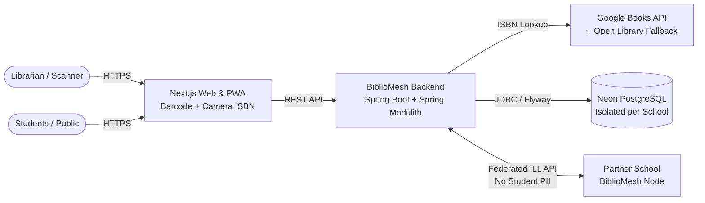

# 📚 BiblioMesh

[](https://github.com/gbolanoscruz/bibliomesh/actions/workflows/security-scan.yml)
[](LICENSE)

Open-source, **federated school library management system** featuring barcode & camera ISBN lookup, Dewey/Cutter cataloging, circulation tracking, a public OPAC, and peer-to-peer **interlibrary loans (ILL)**. Built as a **Modular Monolith** with **Spring Boot (Spring Modulith)**, **Next.js**, and **Neon Serverless PostgreSQL** on a **$0/month cloud architecture**.

---

## 🏛️ Architecture

Each school deploys its own isolated BiblioMesh instance and PostgreSQL database, keeping student data 100% private. Partner libraries can optionally federate over a signed REST contract to search availability and coordinate interlibrary loans.



### Core Modules (`backend/`)

| Module | Responsibility | Status |
| :--- | :--- | :---: |
| **`catalog`** | Bibliographic titles (ISBN auto-fill), physical copies (Dewey, Cutter, inscription #), tech equipment, and spine/barcode label queues | 🚧 Planned |
| **`patrons`** | Students, teachers, and staff profiles (grade/section, borrowing limits) | 🚧 Planned |
| **`circulation`** | External loans, barcode-driven returns, in-room consultations, and overdue tracking | 🚧 Planned |
| **`opac`** | Public read-only catalog search, real-time availability, and digital PDF library links | 🚧 Planned |
| **`interlibrary`** | Federated availability search and library-to-library loan custody workflow | 🚧 Planned |

---

## 🛠️ Tech Stack

- **Backend:** Java 25, Spring Boot, Spring Modulith, Spring Data JPA, Flyway, Spring Security
- **Frontend:** Next.js (React + TypeScript), Tailwind CSS, Browser Barcode/Camera Scanner
- **Database:** Neon Serverless PostgreSQL
- **Hosting ($0/mo):** Google Cloud Run (Backend) + Vercel / Cloudflare (Frontend)
- **CI/CD & DevSecOps:** GitHub Actions, Trivy, CodeQL, Dependabot, GitHub Rulesets

---

## 📂 Repository Structure

```text
bibliomesh/
├── .github/
│   ├── pull_request_template.md
│   └── workflows/               # CI/CD and Trivy security scans
├── backend/                     # Spring Boot + Spring Modulith API
├── frontend/                    # Next.js admin panel + public OPAC
├── docs/
│   └── adr/                     # Architecture Decision Records
├── CONTRIBUTING.md
├── LICENSE                      # GNU GPL v3.0
└── SECURITY.md
```

---

## 🗺️ Roadmap

- [x] Repository bootstrap, GPLv3 license, and DevSecOps guardrails (Rulesets, Trivy, CodeQL)
- [ ] Architecture Decision Records (Spring Modulith & Federated ILL)
- [ ] PostgreSQL schema design (Flyway `V1`) & Spring Modulith skeleton
- [ ] ISBN auto-cataloging (Google Books + Open Library fallback)
- [ ] Next.js Admin Panel + USB/Camera barcode scanner + Public OPAC
- [ ] Federated interlibrary loan module (`interlibrary`)

---

## Documentation

- [Contributing Guide](CONTRIBUTING.md)
- [Security Policy](SECURITY.md)